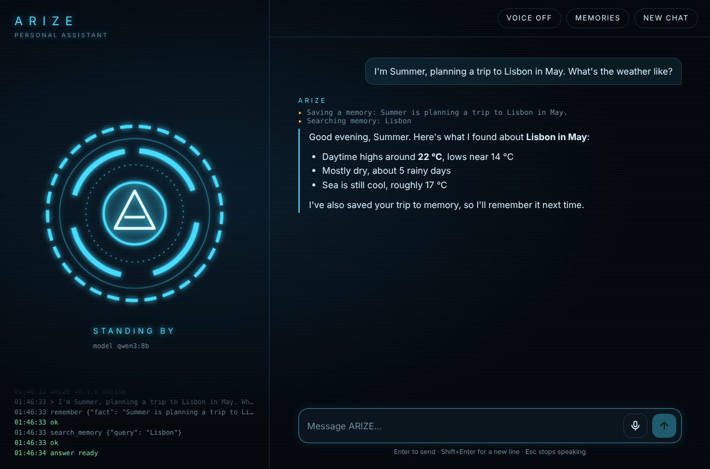

# ARIZE

**A private AI assistant that runs on your own computer.** ARIZE can search the web,
read pages, work with your files, run commands, and remember things about you between
conversations. Your chats and memories stay on your own computer.

```
you › I'm Sam, and I'm planning a trip to Lisbon in May.
  ↳ remember(fact="The user's name is Sam.")
  ↳ remember(fact='Sam is planning a trip to Lisbon in May.')
ARIZE › Nice to meet you, Sam! May is a lovely time for Lisbon...

(next day)
you › what's the weather usually like where I'm going?
  ↳ web_search(query='Lisbon weather in May')
ARIZE › In May Lisbon is usually around 17–23 °C and mostly dry...
```

## Install

1. Install [Ollama](https://ollama.com) and download a model that can use tools:

   ```bash
   ollama pull qwen3:8b
   ```

2. Install ARIZE (needs Python 3.10+). From this folder:

   ```bash
   pip install .
   ```

3. Start chatting:

   ```bash
   arize
   ```

## Desktop app

ARIZE also comes as a desktop app: a dark window with a glowing core that reacts while
ARIZE listens, thinks, uses tools and speaks.

```bash
arize shortcut
```

This puts an **ARIZE** icon on your desktop (and in the Start menu on Windows).
Double-click it to open ARIZE. You can also start it with `arize app`.

- **Talk to it:** click the microphone, speak, and it sends when you stop. Voice input
  uses your browser's speech recognition (Edge or Chrome), which may send audio to
  Microsoft or Google to turn it into text.
- **Hear it:** click **Voice off** to switch it to **Voice on** and ARIZE reads its
  answers out loud using your computer's built-in voices.
- **Memories:** see and delete what ARIZE remembers.
- When ARIZE wants to write a file or run a command, an **Allow / Deny** box appears.

The window is served from your own computer (`127.0.0.1`) and only that window can use
it. ARIZE shuts down on its own about a minute after you close the window.



## Building games in Godot

ARIZE can build and fix Godot 4 games with you. Ask things like:

- *"Make a new Godot game in Documents/Games/dodge where a player dodges falling rocks."*
- *"Look at my project in Documents/Godot/platformer and add double-jump."*
- *"My game crashes when the enemy dies, find out why and fix it."*

ARIZE reads your project, writes GDScript and scenes, then **test-runs the game in the
background and reads Godot's errors**, fixing them until the game runs cleanly. It can
also open your game in a window (`godot_play`) or open the Godot editor.

ARIZE looks for Godot in the usual places (Downloads, Desktop, Program Files, Steam).
If it can't find it, put the full path in your settings file, e.g.
`godot_path = "C:/Users/you/Downloads/Godot_v4.3-stable_win64.exe"`.

## Screen control

ARIZE can see your screen and use your mouse and keyboard, so it can click around the
Godot editor, menus, or a game. Ask things like *"Open the Godot window and click
Run"* or *"In the game, walk forward for 3 seconds then press E"*.

- **Safety:** the first time, ARIZE asks permission to control your mouse and keyboard
  for the next 10 minutes. **To stop it instantly, move your mouse into any corner of
  the screen.**
- **It needs a model that can see.** Run `ollama pull qwen3-vl:8b`, then either use it
  as your main model (`model = "qwen3-vl:8b"`) or only for looking
  (`vision_model = "qwen3-vl:8b"`).
- **It's slow:** every look takes a few seconds. That's fine for menus, editors, and
  turn-based or slow games, but too slow for fast action games.
- Don't use it in online multiplayer games: automation is against most of their rules
  and can get your account banned.

## Using it

| Command | What it does |
|---|---|
| `arize` | Chat. Type `/help` inside for chat commands (`/new`, `/memories`, `/forget N`, `/quit`). |
| `arize ask "question"` | Ask one question and print the answer. |
| `arize memory` | List what ARIZE remembers. |
| `arize memory add "I'm vegetarian"` | Teach it something directly. |
| `arize memory forget 3` | Delete memory #3. `arize memory clear` deletes all. |
| `arize tools` | List the tools ARIZE can use. |
| `arize app` | Open the desktop app window. |
| `arize shortcut` | Create the desktop icon. |
| `arize --model llama3.1` | Use a different model for this run. |
| `arize init` | Create the settings file. |

## Making it faster

How fast ARIZE answers depends on the model and your computer:

- **Pick a smaller model.** `qwen3:4b` is about twice as fast as `qwen3:8b` and still
  uses tools well: run `ollama pull qwen3:4b`, then set `model = "qwen3:4b"` in your
  settings file. On older computers try `llama3.2:3b`.
- **Leave `think = false`** (the default). Turning it on makes qwen3 write a long hidden
  "thinking" section before every answer: sometimes smarter, much slower.
- **A graphics card helps a lot.** Ollama uses an NVIDIA or AMD graphics card, or Apple
  Silicon, automatically. Run `ollama ps` while ARIZE is answering: `100% GPU` is fast,
  `100% CPU` is slow.

### If ARIZE stops answering in long conversations

Models can only remember so much at once (`context_length`, 16384 word pieces by
default). ARIZE asks Ollama for that much, but on a graphics card with little memory
Ollama may be slow. If you get "I didn't get an answer back from the model", click
**New chat**. On a big graphics card you can raise `context_length` to 32768; on a small
one, lower it to 8192.

## Tools

| Tool | What it does | Asks you first? |
|---|---|---|
| `web_search` | Searches the web with DuckDuckGo (no account or key needed) | No |
| `read_webpage` | Opens a link and reads its text | No |
| `read_file`, `list_folder` | Looks at files in your workspace folder | No |
| `write_file` | Creates or changes a file | **Yes** |
| `run_command` | Runs a terminal command | **Yes** |
| `remember`, `search_memory`, `forget` | Manages its long-term memory | No |
| `godot_project`, `godot_editor` | Reads a Godot project, opens the editor | No |
| `godot_new_project`, `godot_set_main_scene` | Creates a project, sets its first scene | **Yes** |
| `godot_run`, `godot_play` | Test-runs the game and reads errors, or opens it in a window | **Yes**, once per 15 min |
| `look_at_screen`, `list_windows`, `wait` | Sees the screen, lists windows | No |
| `click`, `drag`, `move_mouse`, `scroll`, `type_text`, `press_keys`, `hold_keys`, `focus_window` | Uses your mouse and keyboard | **Yes**, once per 10 min |

ARIZE can only touch files inside your **workspace** folder (your home folder by
default; change it in settings).

## Memory

Memories are short facts saved in `~/.arize/memory.db`, a local SQLite
database. ARIZE saves things you tell it on its own (your name, preferences, plans).
Before every reply it looks up the memories that match your message, plus the most
recent ones, and gives them to the model. To see or change memories, use
`/memories` in chat or the `arize memory` commands.

## Settings

`~/.arize/config.toml` is created the first time you run `arize`:

```toml
base_url = "http://localhost:11434/v1"   # Ollama; LM Studio is http://localhost:1234/v1
model = "qwen3:8b"
context_length = 16384                    # how much the model remembers (Ollama only)
api_key = ""                              # only for hosted services
max_steps = 30                            # tool steps allowed per message
confirm_actions = true                    # ask before writing files / running commands
workspace = "~"                           # folder ARIZE may read and write in
think = false                             # let qwen3 "think" first: smarter, much slower
vision_model = ""                         # model for seeing the screen, e.g. "qwen3-vl:8b"
godot_path = ""                           # full path to Godot 4 if ARIZE can't find it
control_minutes = 10                      # how long screen-control permission lasts
```

Every setting can also be set with an environment variable, e.g. `ARIZE_MODEL=llama3.1`.
Set `ARIZE_HOME` to keep settings and memory somewhere other than `~/.arize`.

ARIZE works with any server that speaks the OpenAI chat format, including Ollama,
LM Studio, llama.cpp, vLLM, or a hosted service. The model must support tool calling.

## Development

```bash
pip install -e '.[dev]'
pytest
ruff check . && ruff format --check .
```

The code lives in `src/arize_assistant/`:

- `cli.py`: the `arize` command and chat screen
- `server.py`, `web/index.html`: the desktop app window and the local server behind it
- `desktop.py`: opens the app window and creates shortcuts
- `agent.py`: the loop that calls the model, runs tools, and repeats
- `llm.py`: talks to the model server
- `memory.py`: the memory database
- `tools/`: web, file/command, memory, Godot (`godot.py`) and screen-control
  (`screen.py`) tools. To add a tool, write a function
  and add a `Tool(...)` entry to a module's `TOOLS` list.

## License

MIT, see [LICENSE](LICENSE).
